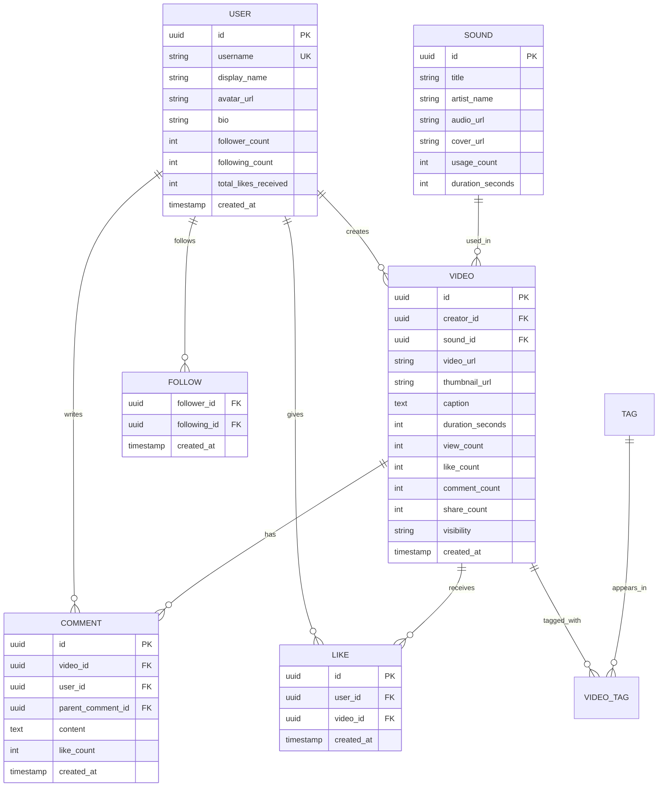

# Recon Map: Short-Form Vertical Video Platform (TikTok / Musically Clone)

Generated by `/replica-recon`
Target: **TikTok (v18.4.41 / com.zhiliaoapp.musically)**
Date: 2026-10-29

---

## 1. Sources

| Source | Type | What it gave us |
| :--- | :--- | :--- |
| `com.zhiliaoapp.musically` APK Bundle | App Bundle Manifest & Resources | Primary navigation tabs, core feature modules (Feed, Creation/Camera, Discovery, Inbox, Profile). |
| Google Play / App Store listing & screenshots | Public App Store | Standard full-screen vertical swipe layout, side interaction action stack, audio disc spinner, bottom navigation. |
| TikTok Creator / Web Portal | Public Documentation | Video length tiers, sound metadata, hashtag categorization, engagement analytics, comment moderation. |

---

## 2. Scope & Target Slice

* **Application**: Short-Form Vertical Video Social App (Mobile Android / iOS / Web).
* **Target Slice**: The Core TikTok Loop:
  1. Full-screen infinite vertical scrolling feed (**For You** and **Following**).
  2. Side action rail (Like, Comment Drawer, Share, Audio Disc).
  3. Video details overlay (Username, Caption, Sound/Music marquee, Hashtags).
  4. Video creation pipeline (Record/Upload, Duration toggle, Sound attachment, Filters, Post flow).
  5. User profile (Bio, Follow stats, Video grid with play counts, Liked tab).
* **Out of Scope (Clean-Room Boundary)**:
  * TikTok Live / Gifting / In-app diamonds currency.
  * TikTok Shop e-commerce logistics and checkout.
  * Proprietary ByteDance recommendation algorithms (we model standard collaborative filtering / tag-based feeds).

---

## 3. Screen Inventory

| ID | Screen Name | Route / Navigation | Purpose | Key Components | States Seen |
| :--- | :--- | :--- | :--- | :--- | :--- |
| **S01** | Feed (For You / Following) | `/feed` (Home Tab) | Core consumption loop with vertical full-screen video paging | `VideoPlayer`, `FeedActionRail`, `FeedMetadataOverlay`, `FeedTopTabs` | Loading, Playing, Paused, Network Error, End of Feed |
| **S02** | Comment Drawer (Modal) | Overlay on S01 | Interactive sheet to view and post nested comments | `CommentSheet`, `CommentRow`, `CommentInputBar`, `EmojiPicker` | Empty (no comments), Loading, Paged list, Replying state |
| **S03** | Share & Export Sheet | Overlay on S01 | Share video link, copy URL, save video | `ShareGrid`, `SocialTargetIcon`, `ActionPill` | Normal, Link Copied Toast |
| **S04** | Discover / Search | `/discover` (Search Tab) | Search by keyword, trending sounds, and hashtag carousels | `SearchBar`, `TrendingBannerCarousel`, `HashtagGridRow`, `SearchResultTabs` | Empty, Search Results (Top, Users, Videos, Sounds), No Results |
| **S05** | Camera / Studio | `/create` (Center [+] Tab) | Record vertical video or pick from gallery | `CameraPreview`, `FlipCameraButton`, `TimerPill`, `SpeedControl`, `RecordButton`, `GalleryPickerButton` | Camera idle, Recording (progress bar fills), Gallery permission prompt |
| **S06** | Video Editor / Post Details | `/create/publish` | Preview recorded clip, trim, write caption & hashtags | `VideoPreviewPlayer`, `CaptionTextArea`, `HashtagChips`, `PrivacySelector`, `PublishButton` | Editing, Tag suggestions popup, Uploading progress modal |
| **S07** | Sound / Audio Detail | `/sound/:soundId` | Audio track page with original sound info and video grid | `SoundHeaderCard`, `UseThisSoundButton`, `SoundVideoGrid`, `PlayAudioSnippet` | Normal, Playing audio preview, Empty grid |
| **S08** | User Profile | `/user/:userId` or `/profile` | Profile header, follow counts, bio, video tabs | `ProfileHeader`, `Avatar`, `FollowButton`, `StatsCounter` (Likes/Following/Followers), `TabSwitcher` (Posts/Liked/Private), `VideoThumbGrid` | Self Profile (Edit button), Other Profile (Follow button), Empty grid |
| **S09** | Inbox / Activity | `/inbox` | Notifications for likes, comments, mentions, and system alerts | `ActivityList`, `NotificationFilterPill`, `DirectMessageRow` | Empty, Paged activity notifications |
| **S10** | Auth / Onboarding Modal | `/auth` | Phone/Email sign in, OTP, and interest selection | `SocialAuthButtons`, `PhoneInput`, `OtpCodeInput` | Sign in, Sign up, Error state (invalid code) |

---

## 4. User Flows

### F01: The Core Feed Consumption Flow
* **Path**: `S01` (App opens straight into For You feed) -> Vertical swipe to next video -> Tap heart to like -> Tap comment icon to open `S02` -> Submit comment -> Dismiss `S02` back to `S01`.
* **Happy path clicks**: 0 clicks to start consuming (auto-play), 1 tap to like, 2 taps to comment.
* **Edge cases**: Network drop mid-video (cache previous chunk), mute toggle on first user interaction, muted audio due to copyright.

### F02: Video Creation & Publishing Flow
* **Path**: `S01` -> Tap [+] button -> `S05` (Camera/Gallery) -> Record 15s clip or select file -> Tap Next -> `S06` (Write caption, add tags, choose cover frame) -> Tap "Post" -> Background upload progress -> Redirects to `S08` (Profile grid shows processing item).
* **Edge cases**: Camera permission denied (prompt OS settings), upload interrupted (retry buffer / draft saved locally), oversized media (transcode to 1080x1920 H.264).

### F03: Sound Discovery & Reuse Flow
* **Path**: `S01` -> Tap spinning audio disc -> `S07` (Sound details) -> Listen to track snippet -> Tap "Use this Sound" -> `S05` (Camera pre-loaded with audio track synced).

---

## 5. UI Component Hierarchy

1. **`VideoPlayerLayer`**: Full-bleed hardware-accelerated video surface, auto-looping, tap-to-pause with center pause icon pulse.
2. **`FeedActionRail`**: Vertical right-aligned HUD containing Avatar with [+] follow badge, Heart (like counter), Message (comment counter), Bookmark, Share arrow, Rotating Audio Disc with vinyl animation.
3. **`FeedMetadataOverlay`**: Bottom-left HUD containing `@username`, verified badge, expandable caption with clickable `#hashtags` and `@mentions`, ticker marquee with sound title and music note animation.
4. **`BottomTabBar`**: Fixed semi-transparent or black tab bar with Home, Discover, Create (+), Inbox, Profile icons.
5. **`CommentDrawer`**: Slide-up bottom sheet with swipe-to-dismiss gesture, nested replies tree, double-tap to like comment, and fixed bottom text field.
6. **`VideoThumbGrid`**: 3-column aspect ratio 3:4 grid with play count overlay and pinned badges.

---

## 6. Inferred Data Model



---

## 7. Next Step in Pipeline

The recon map is established. Proceed to **Step 2**:
```
/replica-architect
```
To design the tech stack, database schema, media ingestion pipeline, and video streaming CDN architecture.
